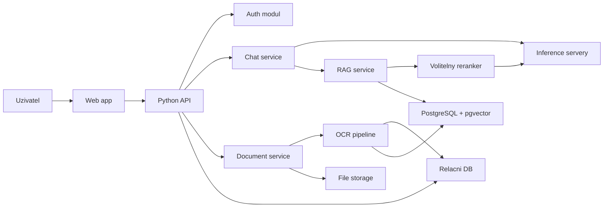

# Architektura

## Cilovy obraz

System tvori webovy frontend, Python API, PostgreSQL/pgvector, OCR worker a externi inference servery. Backend podporuje Ollama i OpenAI kompatibilni API (llama.cpp). Frontend, nginx, Python API a OCR worker sdileji jeden kontejner `receiptchat`; PostgreSQL bezi v samostatnem kontejneru. Ollama i llama.cpp zustavaji externi zdroje.

## Aktualni stav

Aktivni casti systemu:

- Web app.
- Python API.
- Auth modul.
- Chat service.
- Document service.
- OCR worker.
- RAG service s pgvector.
- Volitelny reranker.
- Klienti pro chat, embedding, OCR a strukturovani pres Ollama nebo OpenAI kompatibilni API; reranking pres Ollama.
- Relacni databaze pro uzivatele, dokumenty, historii chatu a embeddings.

## Backend moduly

- `auth`: registrace, prihlaseni, hash hesel, HTTP-only cookie session.
- `users`: sprava uzivatelske identity a uzivatelskych nastaveni.
- `chat`: konverzace, zpravy, agentni rozhodnuti, RAG a finalni odpoved.
- `llm`: adapter pro Ollama a OpenAI kompatibilni API, vyber modelu, timeouty, chyby.
- `documents`: upload, metadata, soubory dokladu a stav zpracovani.
- `ocr`: extrakce textu z dokumentu.
- `rag`: skladani RAG textu, embeddings, vyhledavani relevantniho kontextu.
- `reranker`: volitelne preskupeni kandidatu z RAG podle dotazu.
- `inference`: routing roli mezi nakonfigurovanymi Inference servery.

## Datovy model

Zakladni entity:

- `User`: id, email, password_hash, created_at, is_active.
- `Conversation`: id, user_id, title, created_at, updated_at.
- `Message`: id, conversation_id, role, content, model, retrieval metadata, created_at.
- `Document`: id, user_id, filename, mime_type, storage_path, status, created_at.
- `DocumentFile`: id, document_id, user_id, filename, mime_type, storage_path, sort_order, created_at.
- `OcrResult`: id, document_id, raw_text, normalized_text, metadata_json, language, page_count, engine, created_at.
- `DocumentExtraction`: id, document_id, structured_json, summary, review_status, model, raw_response, created_at.
- `UserSettings`: default_chat_model, ocr_processing_model, source strategy and reranker thresholds.
- `DocumentChunk`: id, document_id, text, embedding, metadata.
- `InferenceRoutingSettings`: role assignment for chat, embedding, reranker, OCR and structuring across Ollama servers.

## Chat flow

1. Frontend odesle zpravu na backend.
2. Backend overi uzivatele.
3. Backend ulozi uzivatelskou zpravu.
4. Agent rozhodne, zda muze odpovedet primo, nebo musi hledat v dokladech.
5. Pokud je potreba hledat, backend pouzije strukturovane hledani, RAG a volitelny reranker.
6. Backend sestavi kontext konverzace a nalezenych zdroju.
7. Backend zavola vybrany chat model na prirazenem inference serveru.
8. Backend ulozi odpoved asistenta a vrati ji vcetne zdroju.

## RAG flow

1. Uzivatel nahraje dokument.
2. Backend ulozi jeden nebo vice souboru/fotek do slozky dokladu.
3. OCR pipeline vytahne text ze vsech souboru dokladu ve spravnem poradi.
4. LLM post-processing ve vychozim rezimu `vision_hybrid` posle do modelu OCR text i obrazky dokladu a vytvori strukturovana pole a lidsky popisek dokladu.
5. Uzivatel muze zkontrolovat a upravit strukturovana pole.
6. Backend indexuje deterministicky slozeny `rag_text`: popisek, klicova strukturovana pole, polozky, mnozstvi, jednotkove ceny, raw text polozek a uzivatelske poznamky.
7. Pri dotazu chat service vyzada relevantni dokumenty/chunky z RAG service.
8. Pokud je zapnuty reranker, kandidati se preskupuji podle dotazu.
9. Model dostane dotaz, historii a dokumentovy kontext vcetne odkazu na zdroj.
10. Odpoved obsahuje odkazy na detail dokladu.

## LLM zpracovani dokladu

OCR vystup neni finalni datovy produkt. Uklada se jako auditovatelny raw/normalizovany text. Nad nim bezi samostatny LLM krok pres vybrany inference server. Vychozi rezim je hybridni: model dostane OCR text jako datovou kotvu a obrazek/fotky dokladu jako vizualni kotvu pro layout, tabulky a role poli.

Vystup obsahuje:

- strukturovana pole dokladu,
- kratky lidsky popisek vhodny pro embedding,
- confidence/nejistoty a odkazy na evidence v OCR textu,
- polozky vcetne mnozstvi, jednotek, cen a raw textu.

Model pro OCR post-processing je perzistentne nastavitelny v uzivatelskem nastaveni. Pokud neni vybran, pouzije se prvni model dostupny na prirazenem serveru (stare env defaulty zustavaji kompatibilni pro primo spousteny backend). Spravce v aplikaci konfiguruje adresy, typy API, sifrovane pristupove udaje, OCR/RAG parametry a prirazeni roli chat, embedding, reranker, OCR a structuring. Nastaveni je spolecne pro API a worker a uklada se v PostgreSQL.

## Bezpecnostni zasady

- Data uzivatelu jsou oddelena pres `user_id` a autorizacni kontroly na backendu.
- Hesla se nikdy neukladaji v ciste podobe.
- Upload dokumentu kontroluje typ souboru, velikost a pristupova prava.
- LLM nesmi dostat dokumenty jineho uzivatele.
- Pro produkci je potreba HTTPS, secure cookies, CORS omezeny na frontend origin a reverzni proxy.

## GPU a CPU

Chat a strukturovani mohou sdilet jeden prednacteny model na GPU pres llama.cpp. V rezimu `vision_hybrid` musi server podporovat obrazovy vstup a mit nacteny odpovidajici multimodalni projektor; jinak v nastaveni OCR a zpracovani zvolte vstup pouze z OCR textu.

EasyOCR bezi lokalne na CPU (`gpu=False`); Tesseract take nevyzaduje GPU. Embeddingy a volitelny reranker pouzivaji samostatne modely. Pro CPU embedding a reranking lze vyuzit druhy Ollama server bez GPU. Prirazeni roli se uklada v nastaveni aplikace; zmena embedding modelu vyzaduje nove zaindexovani dokumentu.

## Provoz jednoho aplikacniho kontejneru

Root `Dockerfile` sestavi frontend a vlozi jej do Python image s nginx, Supervisorem a OCR zavislostmi. Kontejner publikuje port 8080; hostitelsky port urcuje `APP_PORT` (vychozi 5173). nginx obsluhuje frontend a proxyuje `/api` na backend poslouchajici pouze na `127.0.0.1:8000`.

Start nejprve provede kompatibilitni kontrolu databaze a Alembic migrace. Potom Supervisor spusti backend, worker a nginx. `tini` zajistuje predani signalu a uklid potomku; procesy maji definovane casy pro ukonceni. Healthcheck kontroluje vsechny tri procesy i odpoved API pres nginx.

Worker drzi PostgreSQL advisory lock po celou dobu behu. Po jeho ziskani vrati prerusene `running` OCR a extraction joby do fronty. Pri aktualizaci se proto nejprve zastavi stary stack; nad jednou databazi se provozuje jedna aplikacni instance.
